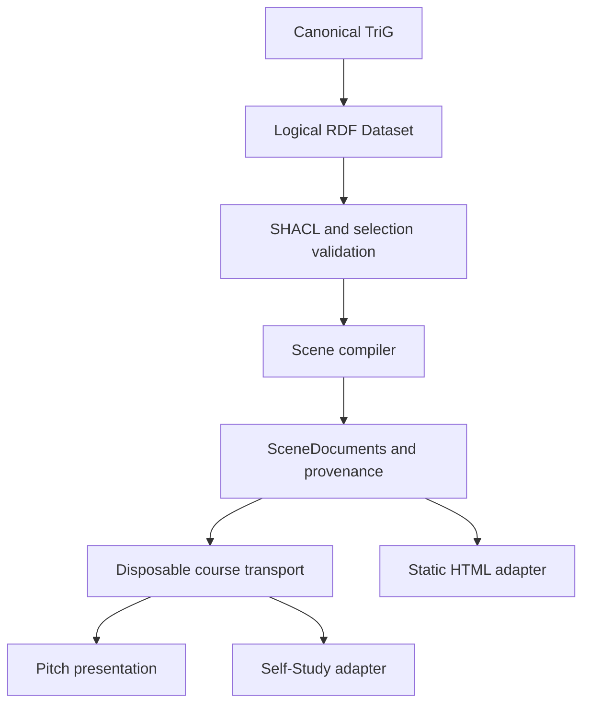

# Architecture

The current application compiles a local RDF Dataset into static browser assets.
It runs without a database or application server. Apache Jena Fuseki is the
planned persistent RDF service; the optional semantic-client and local Fuseki
tools are separate from the production course build.

## Authored source and compilation

TriG files under `ontology/dataset/` are the sole authored semantic source.
Named graph identities remain intact through assembly, validation, selection and
projection. JSON files are generated transport, never a parallel authoring model.
Retired Turtle and JSON-LD inputs are not active sources.

`scripts/rdf_dataset.py` owns assembly, deterministic N-Quads export and the Dataset
fingerprint. Blank-node identity is scoped across the logical Dataset, including
nodes shared by named graphs. Export and fingerprinting use the same Dataset-wide
representation. Independent round-trip tests verify preservation of quads, graph
contexts and shared blank-node identity. This is a project-specific canonical
representation, not a claim of W3C RDFC-1.0 interoperability.

`scripts/generate_canonical_runtime.py` compiles validated selections and snapshots.
The compiler does not own the static output implementation:
`scripts/static_course_fallback.py` renders inert HTML from the resulting scene data.
Selection validation and teaching-offering projection remain separate modules.

## Runtime contracts and adapters

| Boundary | Responsibility |
| --- | --- |
| `packages/core` | Renderer-neutral scene contracts, raw input validation, version capabilities, RDF identity, graph projection and scientific data models. |
| `packages/semantic-client` | RDF service queries and optional Fuseki integration. |
| `packages/learner-state` | Local learner-state contracts, separate from authored RDF. |
| `packages/renderer-shared` | Pure inline mathematics, symbol definitions and derivation markup shared by output adapters. |
| `packages/renderer-reveal` | Presentation planning, themes and the encapsulated Reveal adapter. |
| `packages/renderer-d3` | Charts, diagrams, graph layouts and updates to mounted graphics. |
| `packages/renderer-self-study` | Self-study output using core contracts and shared teaching rendering. |
| `apps/pitch` | Browser composition, navigation, lazy loading, editors, local webR and lifecycle orchestration. |
| `apps/self-study` | The self-study application and static generation. |

Core must not import Reveal, D3, a browser application or output-specific DOM code.
Self-Study must not import implementation files from the Reveal adapter. Both
renderers depend on the shared teaching-rendering package. Existing Reveal helper
exports remain compatibility aliases.

Raw `SceneDocument` input is validated before use. Validation checks discriminated
block kinds and their nested structure before semantic invariants access typed
properties. `scene-version.ts` is the single capability table for supported
additive versions. Unknown future versions fail explicitly. Nested groups are
discovered by the shared recursive `scene-blocks.ts` iterator; renderers continue
to apply the authored reading order.

## Course transport and delivery

The production builder creates an isolated public-assets tree containing tracked
application assets and the integrity-verified editor/R runtime. Development
previews, obsolete course payloads and untracked public files are excluded.

Transport version 2 has three parts:

1. `course-runtime/manifest.json` contains the offering, exact document bindings,
   scene identities, revision and content hashes. The course map loads this small
   manifest without loading presentation code or a semantic snapshot.
2. A content-addressed `level-*.json` carries one SceneDocument and the complete
   one-hop RDF neighborhood needed by its scene graph views. Original source and
   provenance records are retained. The loader validates the hash, identity and
   revision before mounting the presentation.
3. One `graph-*.json` contains the complete Dataset snapshot for an explicit
   whole-Dataset view. Ordinary level navigation does not fetch it.

The separate `course-runtime/static-course.html` remains available without
JavaScript and from the visible startup error screen. Retry restarts initialization
cleanly. A failed build invalidates prior success evidence and preserves unfamiliar
output instead of silently accepting it.

Interactive charts keep their mounted SVG and update marks when data changes.
Live updates pause outside the active scene or while the document is hidden.
Cached page transitions pause work and preserve mounted state; real disposal
releases listeners, timers, observers, editors and workers.

R examples use the pinned local webR runtime and a shared serial session. Stop and
Restart clear that session, cancel queued work and permit a fresh worker on the
next Run. Reset restores the editor and output; revision checks prevent a previous
execution from overwriting a reset or disposed workspace. Browser zoom is retained
when presentation gestures are intercepted.

## Verification

`npm test` is the authoritative project command and includes strict TypeScript
checking in addition to semantic, contract, renderer and application tests.
`npm run verify:release -- --offline` runs preflight, the full project tests, a
production build, artifact verification and built-site browser smoke checks.
It does not publish the result. See [technical verification](technical-verification.md)
for setup, browser selection, evidence and remaining boundaries.

The external `agent-validator/project-chemie-digital` commit status is still required
on the exact PR head for acceptance. Local logs and browser reports are diagnostic
evidence. GitHub Actions are not part of this validation path.
