# Environmental Health 2026: production storyboard

Production target: 870 seconds (14:30), including transitions. Hard limit: 900 seconds (15:00). This is an authored budget, not a measured recording. The final 30 seconds are contingency, not extra planned content.

Every scene has its own heading, items and English narration. Manuscript V1 is retained verbatim apart from document line-ending normalization. Source-supplied word counts are retained as metadata; whitespace-token counts are reported separately rather than silently correcting the supplied counts.

Cover decision: use generic HeadingRole, ChartRole and KeyPointRole items. presentationTitleOf would suppress the additional evidence blocks in the existing renderer. The visible heading is From Signal to Evidence. The footer has two ordered key points: the full ScientificTalk title, then the unchanged author/affiliation/event and replicate/uncertainty statement. Scenes 01, 02, 04, 06, 07 and 08 select cd:hasKeyPoint from their existing Interpretation owners through KeyPointRole; their full caveats remain visible in the bounded chart-and-list composition.

Manual FIFO adaptation: the old timed replay window is not selected. The new chart copies the original chart parameters and references the same 44 paired observations. Only windows 01..15, 02..16 and 03..17 are selected. Each navigation removes one standard and adds one. Balanced order is not acquisition chronology, and none of these windows establishes an optimal size or drift correction.

Visual policy: existing light 16:9 system, with background=none for the recording preview. No custom assets or renderer JavaScript changes. Browser review required one generic bounded chart-caption spacing rule in visual-stage-primitives.css to separate axis labels and captions; it excludes scroll presentations. Reserve a separate lower band for Persian subtitles during capture. The QA report distinguishes browser checks from recording and subtitle checks. Essential caveats are ordinary visible text, including key-point lists on chart scenes, not hover or modal content.

Static/PDF reading: each chart or diagram has a semantic body and a visible scene takeaway. Scientific order is explicit in nodes and labeled edges. Static exports must retain all nodes, semantic node descriptions, window labels and before/after descriptions; inspect the actual export before recording. No scientific conclusion depends solely on motion.

## Production timing fixture

| Scene | Start | End | Seconds | Supplied words | Whitespace words | Planned pause/transition allowance |
|---|---|---|---:|---:|---:|---:|
| eh26-scene-01 | 00:00 | 00:30 | 30 | 51 | 51 | 5 s |
| eh26-scene-02 | 00:30 | 01:35 | 65 | 118 | 118 | 5 s |
| eh26-scene-03 | 01:35 | 02:40 | 65 | 118 | 118 | 5 s |
| eh26-scene-04 | 02:40 | 03:55 | 75 | 119 | 119 | 5 s |
| eh26-scene-05 | 03:55 | 05:20 | 85 | 137 | 137 | 5 s |
| eh26-scene-06 | 05:20 | 06:35 | 75 | 127 | 127 | 5 s |
| eh26-scene-07 | 06:35 | 08:15 | 100 | 173 | 173 | 5 s |
| eh26-scene-08 | 08:15 | 09:35 | 80 | 138 | 138 | 5 s |
| eh26-scene-09 | 09:35 | 11:15 | 100 | 167 | 167 | 5 s |
| eh26-scene-10 | 11:15 | 12:45 | 90 | 150 | 150 | 5 s |
| eh26-scene-11 | 12:45 | 13:55 | 70 | 119 | 119 | 5 s |
| eh26-scene-12 | 13:55 | 14:30 | 35 | 60 | 60 | 5 s |

The remaining time in each scene is the planned speech-and-gesture envelope. Rehearse natural speech with the actual stages. If it exceeds the budget, seek an explicitly versioned manuscript revision rather than silently speeding playback or extending the target.

## 01. From Signal to Evidence

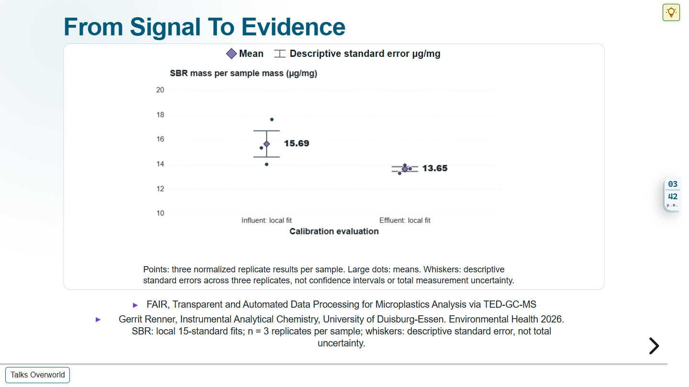

Narrative intention: An analytical result needs the evidence behind its number.

Time budget: 30 seconds, including 5 planned seconds for pauses, pointing and transition. Supplied word count: 51; whitespace-token count: 51.

Visual composition: Generic short heading From Signal to Evidence, local-only SBR dot plot and a two-point footer list: full ScientificTalk title first, unchanged compact author/affiliation/event and replicate/uncertainty statement second. No title-metadata special layout.

Path step: `ex:eh26-step-01`. Scene: `ex:eh26-scene-01`. Heading: `ex:eh26-heading-01`. Visual: `ex:ted-sample-comparison-chart`. Takeaway: `ex:eh26-statement-01`. Items: `ex:eh26-item-01-1`, `-2`, `-3`.

Actual authored source files (selected visual and outgoing semantic dependencies):

- `ontology/dataset/talks-ted-calibration.trig`
- `ontology/dataset/talks-ted-sample-comparison.trig`

Reveal cues, keyed to the exact V1 paragraph starts below:

- P1, "Environmental monitoring increasingly depends on results derived from complex instrumental data.": Entry: title, author/event credits and the existing local SBR evidence chart are visible. No click needed.
- P2, "In TED-GC-MS, we do not directly count microplastic particles. We measure chemical signals that can be used to estimate polymer mass.": Keep the evidence visible while distinguishing chemical signals from particle counts.
- P3, "Today, I will focus on what happens between that signal and the reported result: processing, documentation, and controlled automation.": Hold; introduce processing, documentation and controlled automation.

Voice-over V1:

P1. Environmental monitoring increasingly depends on results derived from complex instrumental data.

P2. In TED-GC-MS, we do not directly count microplastic particles. We measure chemical signals that can be used to estimate polymer mass.

P3. Today, I will focus on what happens between that signal and the reported result: processing, documentation, and controlled automation.

## 02. A Number Is Not the Whole Story

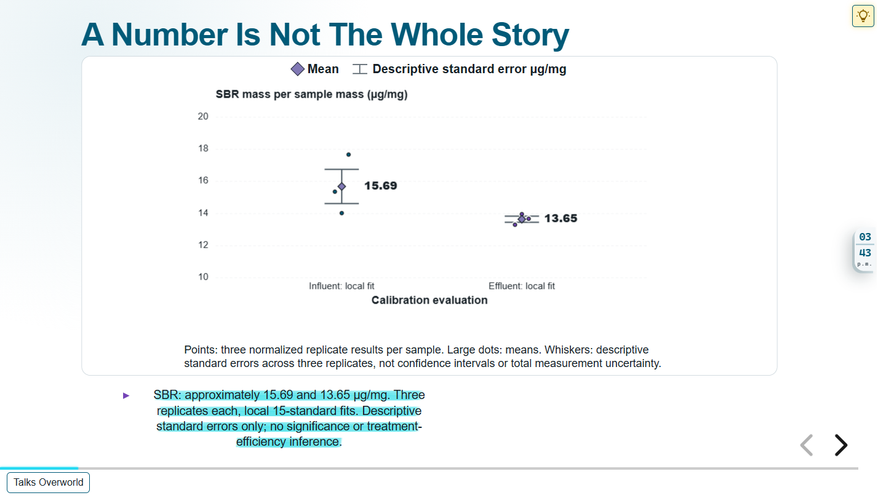

Narrative intention: Interpretation and comparison require signal, calibration and software context.

Time budget: 65 seconds, including 5 planned seconds for pauses, pointing and transition. Supplied word count: 118; whitespace-token count: 118.

Visual composition: The same local-only two-group result chart, now read as an evidence question rather than a treatment comparison.

Path step: `ex:eh26-step-02`. Scene: `ex:eh26-scene-02`. Heading: `ex:eh26-heading-02`. Visual: `ex:ted-sample-comparison-chart`. Takeaway: `ex:eh26-statement-02`. Items: `ex:eh26-item-02-1`, `-2`, `-3`.

Actual authored source files (selected visual and outgoing semantic dependencies):

- `ontology/dataset/talks-ted-calibration.trig`
- `ontology/dataset/talks-ted-sample-comparison.trig`

Reveal cues, keyed to the exact V1 paragraph starts below:

- P1, "Consider these two results for SBR, styrene-butadiene rubber, from an influent and an effluent sample.": Entry: show both local groups together.
- P2, "One result is about fifteen point seven micrograms per milligram of sample; the other is about thirteen point six.": Point to the means without changing the data or implying significance.
- P3, "These values are derived from three analytical replicates each. But the numbers alone tell us remarkably little.": Point to the three replicates and descriptive whiskers.
- P4, "Which chromatographic signals were selected? How were overlapping signals handled? Which calibration standards were used? And which version of the processing software produced the result?": Hold the chart while asking the four provenance questions.
- P5, "To evaluate or reproduce the analysis, we need answers to those questions.": Hold through the remaining paragraphs; no extra reveal.

Voice-over V1:

P1. Consider these two results for SBR, styrene-butadiene rubber, from an influent and an effluent sample.

P2. One result is about fifteen point seven micrograms per milligram of sample; the other is about thirteen point six.

P3. These values are derived from three analytical replicates each. But the numbers alone tell us remarkably little.

P4. Which chromatographic signals were selected? How were overlapping signals handled? Which calibration standards were used? And which version of the processing software produced the result?

P5. To evaluate or reproduce the analysis, we need answers to those questions.

P6. This is the problem we want to address: not simply producing a number, but preserving the evidence behind it.

P7. These distinctions matter when results are compared across laboratories or studies.

## 03. TED-GC-MS in One Minute

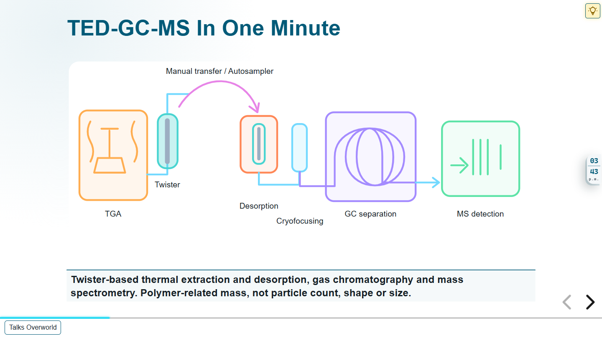

Narrative intention: This Twister-based method infers polymer-related mass from chemical signals.

Time budget: 65 seconds, including 5 planned seconds for pauses, pointing and transition. Supplied word count: 118; whitespace-token count: 118.

Visual composition: Large existing Twister apparatus illustration with a single mass-versus-particles statement.

Path step: `ex:eh26-step-03`. Scene: `ex:eh26-scene-03`. Heading: `ex:eh26-heading-03`. Visual: `ex:ted-setup-illustration`. Takeaway: `ex:eh26-statement-03`. Items: `ex:eh26-item-03-1`, `-2`, `-3`.

Actual authored source files (selected visual and outgoing semantic dependencies):

- `ontology/dataset/talks-ted-setup.trig`

Reveal cues, keyed to the exact V1 paragraph starts below:

- P1, "First, a brief look at the measurement.": Entry: apparatus overview is complete and non-empty.
- P2, "In our TED-GC-MS configuration, the sample is heated under controlled conditions. Organic compounds are released, and polymers can decompose into characteristic products.": Point to controlled heating.
- P3, "Part of the evolved gas stream passes a sorptive device, shown here as a Twister.": Point to upright Twister capture.
- P4, "The loaded sorbent is transferred to a thermal desorption system. The collected substances are released, focused at low temperature, separated by gas chromatography, and detected by mass spectrometry.": Follow sorbent transfer, desorption, cryofocusing, GC and MS.
- P5, "The mass spectrometer observes ions formed from the separated substances, rather than intact polymer particles.": Point to ion detection, not particle detection.
- P6, "These signals are then interpreted through characteristic markers and calibration measurements.": Keep the whole apparatus visible through the final mass-based interpretation.

Voice-over V1:

P1. First, a brief look at the measurement.

P2. In our TED-GC-MS configuration, the sample is heated under controlled conditions. Organic compounds are released, and polymers can decompose into characteristic products.

P3. Part of the evolved gas stream passes a sorptive device, shown here as a Twister.

P4. The loaded sorbent is transferred to a thermal desorption system. The collected substances are released, focused at low temperature, separated by gas chromatography, and detected by mass spectrometry.

P5. The mass spectrometer observes ions formed from the separated substances, rather than intact polymer particles.

P6. These signals are then interpreted through characteristic markers and calibration measurements.

P7. The approach is therefore mass-based: it can provide information about polymer-related mass, but not individual particle counts, shapes, or sizes.

## 04. From Chromatograms to Polymer Markers

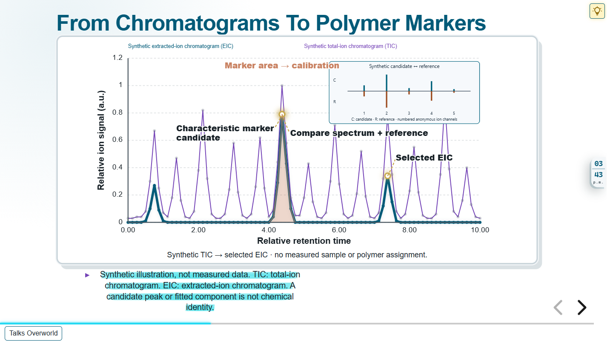

Narrative intention: A chromatographic peak requires retention, spectral and interference evidence.

Time budget: 75 seconds, including 5 planned seconds for pauses, pointing and transition. Supplied word count: 119; whitespace-token count: 119.

Visual composition: Large synthetic chromatogram with its existing TIC, EIC, candidate, spectrum/reference and area stages.

Path step: `ex:eh26-step-04`. Scene: `ex:eh26-scene-04`. Heading: `ex:eh26-heading-04`. Visual: `ex:ted-marker-chromatogram`. Takeaway: `ex:eh26-statement-04`. Items: `ex:eh26-item-04-1`, `-2`, `-3`.

Actual authored source files (selected visual and outgoing semantic dependencies):

- `ontology/dataset/talks-ted-calibration.trig`
- `ontology/dataset/talks-ted-chromatogram.trig`
- `ontology/dataset/talks-ted-knowledge.trig`
- `ontology/dataset/talks-ted-revisions.trig`

Reveal cues, keyed to the exact V1 paragraph starts below:

- P1, "The instrument does not produce a table of polymer concentrations. It produces ion signals over time.": Entry: the existing first TIC stage appears automatically.
- P2, "A total-ion chromatogram summarizes the detected signal, but a useful interpretation often begins with individual extracted-ion chromatograms.": Next: selected EIC, with TIC retained as context.
- P3, "We search for characteristic decomposition products and examine their retention behavior and mass-spectral information.": Next to the candidate stage; next to spectrum/reference while explaining retention and spectral evidence.
- P4, "Here, one signal becomes a candidate marker.": Hold the candidate/reference view.
- P5, "However, environmental matrices are complex, peaks may overlap, and different substances may contribute to similar signals.": Hold for matrix and overlap limitations.
- P6, "So a peak is not automatically proof of a polymer.": Keep the synthetic-illustration and identity caveat visible.
- P7, "Before we calculate concentrations, we need a reproducible way to locate relevant signals, associate them with components, and select markers according to an explicit analytical method.": Next: area stage; hold through paragraph 8.

Voice-over V1:

P1. The instrument does not produce a table of polymer concentrations. It produces ion signals over time.

P2. A total-ion chromatogram summarizes the detected signal, but a useful interpretation often begins with individual extracted-ion chromatograms.

P3. We search for characteristic decomposition products and examine their retention behavior and mass-spectral information.

P4. Here, one signal becomes a candidate marker.

P5. However, environmental matrices are complex, peaks may overlap, and different substances may contribute to similar signals.

P6. So a peak is not automatically proof of a polymer.

P7. Before we calculate concentrations, we need a reproducible way to locate relevant signals, associate them with components, and select markers according to an explicit analytical method.

P8. The choice of ion trace and integration region also affects the reported mass.

## 05. The Data Processing Chain

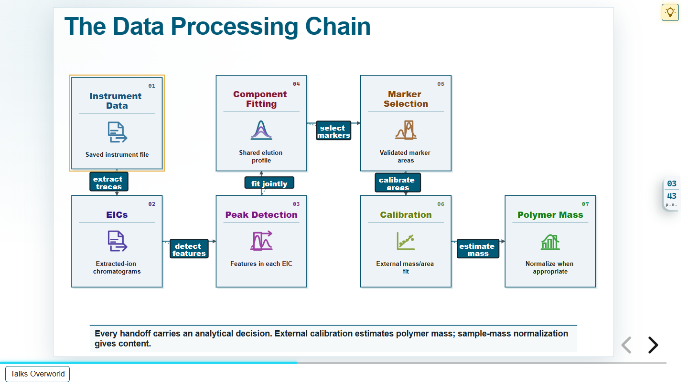

Narrative intention: Each processing boundary preserves an analytical decision.

Time budget: 85 seconds, including 5 planned seconds for pauses, pointing and transition. Supplied word count: 137; whitespace-token count: 137.

Visual composition: New seven-node scientific processing flow. Five cumulative, non-empty semantic states.

Path step: `ex:eh26-step-05`. Scene: `ex:eh26-scene-05`. Heading: `ex:eh26-heading-05`. Visual: `ex:eh26-processing-flow`. Takeaway: `ex:eh26-statement-05`. Items: `ex:eh26-item-05-1`, `-2`, `-3`.

Actual authored source files (selected visual and outgoing semantic dependencies):

- `ontology/dataset/talks-environmental-health-2026.trig`
- `ontology/dataset/talks-ted-calibration.trig`
- `ontology/dataset/talks-ted-knowledge.trig`
- `ontology/dataset/talks-ted-processing.trig`
- `ontology/dataset/talks-ted-revisions.trig`
- `ontology/dataset/talks-ted-sample-comparison.trig`

Reveal cues, keyed to the exact V1 paragraph starts below:

- P1, "This is our processing chain.": Entry state 1: Instrument Data and EICs, plus their extraction arrow.
- P2, "We first import the instrument data and extract ion chromatograms.": Hold state 1 for import and extraction.
- P3, "Next, peak detection turns continuous signals into a list of chromatographic features.": Next state 2: Peak Detection and detect-features arrow.
- P4, "Joint fitting then combines features that share an elution profile into components.": Next state 3: Component Fitting and joint-fit arrow.
- P5, "We select components associated with polymer markers, estimate marker areas, and use external calibration to calculate polymer-related mass.": Next state 4: Marker Selection; next state 5: Calibration and Polymer Mass.
- P6, "Finally, we normalize that mass to the sample mass where appropriate.": Hold the complete chain for normalization and all remaining paragraphs.

Voice-over V1:

P1. This is our processing chain.

P2. We first import the instrument data and extract ion chromatograms.

P3. Next, peak detection turns continuous signals into a list of chromatographic features.

P4. Joint fitting then combines features that share an elution profile into components.

P5. We select components associated with polymer markers, estimate marker areas, and use external calibration to calculate polymer-related mass.

P6. Finally, we normalize that mass to the sample mass where appropriate.

P7. Every arrow represents more than a file transfer.

P8. It represents a scientific decision: a peak model, a fitting rule, a marker definition, or a calibration choice.

P9. Those decisions are exactly what a transparent processing pipeline must preserve.

P10. Each operation receives an input, applies a defined transformation, and produces an output.

P11. Documenting these boundaries lets us inspect, validate, and potentially replace implementations without losing the scientific meaning of the workflow.

## 06. Automated Peak Detection

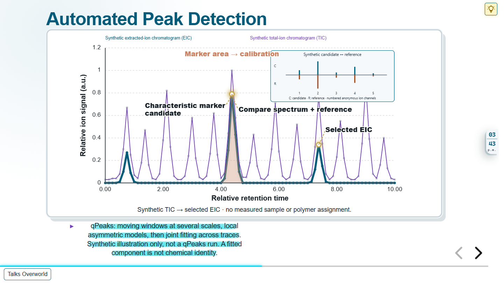

Narrative intention: Automated detection and joint fitting require explicit settings and review.

Time budget: 75 seconds, including 5 planned seconds for pauses, pointing and transition. Supplied word count: 127; whitespace-token count: 127.

Visual composition: Existing synthetic chromatogram again, with the full authored qPeaks method and caveat text in a visible key-point list. This is not an algorithm-output visualization.

Path step: `ex:eh26-step-06`. Scene: `ex:eh26-scene-06`. Heading: `ex:eh26-heading-06`. Visual: `ex:ted-marker-chromatogram`. Takeaway: `ex:eh26-statement-06`. Items: `ex:eh26-item-06-1`, `-2`, `-3`.

Actual authored source files (selected visual and outgoing semantic dependencies):

- `ontology/dataset/talks-ted-calibration.trig`
- `ontology/dataset/talks-ted-chromatogram.trig`
- `ontology/dataset/talks-ted-knowledge.trig`
- `ontology/dataset/talks-ted-revisions.trig`

Reveal cues, keyed to the exact V1 paragraph starts below:

- P1, "For peak detection, we use our qPeaks approach.": Entry: synthetic TIC, not a qPeaks output or benchmark.
- P2, "Instead of relying on a single fixed peak width, the algorithm examines each extracted-ion chromatogram with moving regression windows at several scales.": Next to EIC for moving-window explanation; no claim that the chart executes the algorithm.
- P3, "Potential peaks are described using a local asymmetric model, and suitable candidates can then be evaluated further.": Next to candidate for local-model explanation.
- P4, "In a second step, signals across different ion traces can be fitted together when they share a chromatographic elution profile.": Hold for joint fitting across traces; the chart is only illustrative.
- P5, "This helps organize many individual features into meaningful components.": Hold through component and responsibility paragraphs.
- P7, "Window sizes, fitting settings, acceptance criteria, and marker assignments must remain explicit, because different choices can change which features enter the final calculation.": Next to spectrum/reference for evidence checks; next to area while discussing explicit settings. Hold for paragraph 8.

Voice-over V1:

P1. For peak detection, we use our qPeaks approach.

P2. Instead of relying on a single fixed peak width, the algorithm examines each extracted-ion chromatogram with moving regression windows at several scales.

P3. Potential peaks are described using a local asymmetric model, and suitable candidates can then be evaluated further.

P4. In a second step, signals across different ion traces can be fitted together when they share a chromatographic elution profile.

P5. This helps organize many individual features into meaningful components.

P6. But automation does not remove the responsibility to evaluate them.

P7. Window sizes, fitting settings, acceptance criteria, and marker assignments must remain explicit, because different choices can change which features enter the final calculation.

P8. Several ion traces may contain the same chromatographic peak, but at different intensities; joint analysis preserves this relationship.

## 07. Calibration Is Part of Processing

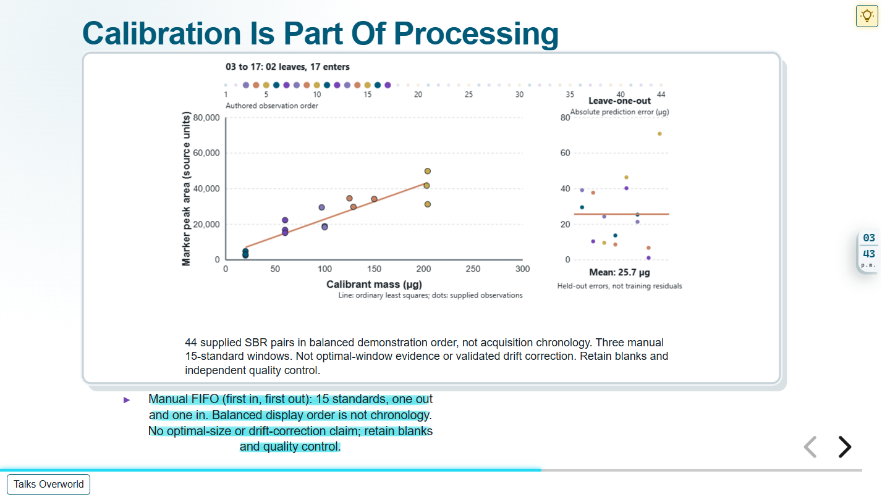

Narrative intention: The exact calibration selection belongs to provenance.

Time budget: 100 seconds, including 5 planned seconds for pauses, pointing and transition. Supplied word count: 173; whitespace-token count: 173.

Visual composition: Own regression chart, same 44 observations and chart parameters; exactly three static 15-member windows.

Path step: `ex:eh26-step-07`. Scene: `ex:eh26-scene-07`. Heading: `ex:eh26-heading-07`. Visual: `ex:eh26-fifo-chart`. Takeaway: `ex:eh26-statement-07`. Items: `ex:eh26-item-07-1`, `-2`, `-3`.

Actual authored source files (selected visual and outgoing semantic dependencies):

- `ontology/dataset/talks-environmental-health-2026.trig`
- `ontology/dataset/talks-ted-calibration.trig`

Reveal cues, keyed to the exact V1 paragraph starts below:

- P1, "Calibration is another part of data processing that deserves attention.": Entry window 1: observations 01 through 15. No timer.
- P2, "A conventional calibration may involve a substantial number of standards and blank measurements, making it time-consuming in a long analytical campaign.": Hold through calibration overhead and FIFO definition, paragraphs 2 through 5.
- P6, "The existing demonstration replays forty-four SBR calibration measurements in a balanced order and updates the fitted line as the window moves.": Next window 2: 01 leaves and 16 enters. Next window 3: 02 leaves and 17 enters. Explain balanced display order, not acquisition chronology.
- P7, "It illustrates the procedure, but does not independently establish long-term performance or optimal window size.": Hold final window for performance and optimal-size limitations.
- P8, "Drift, blank measurements, quality control, and calibration validity still have to be assessed.": Hold for blanks and independent quality control.
- P9, "The key point for our topic is that the selected calibration window is itself part of the result's provenance.": Hold through provenance and drift-correction caveats.

Voice-over V1:

P1. Calibration is another part of data processing that deserves attention.

P2. A conventional calibration may involve a substantial number of standards and blank measurements, making it time-consuming in a long analytical campaign.

P3. Our working concept is running calibration: maintain a set of fifteen standards, add a newly measured standard, and remove the oldest one.

P4. This is a first-in, first-out, or FIFO, window.

P5. The idea is to use calibration information close to the time of a sample rather than treating calibration as a separate event at the beginning of a campaign.

P6. The existing demonstration replays forty-four SBR calibration measurements in a balanced order and updates the fitted line as the window moves.

P7. It illustrates the procedure, but does not independently establish long-term performance or optimal window size.

P8. Drift, blank measurements, quality control, and calibration validity still have to be assessed.

P9. The key point for our topic is that the selected calibration window is itself part of the result's provenance.

P10. A moving window is not automatically a valid drift correction or a substitute for quality control.

## 08. From Marker Area to SBR Content

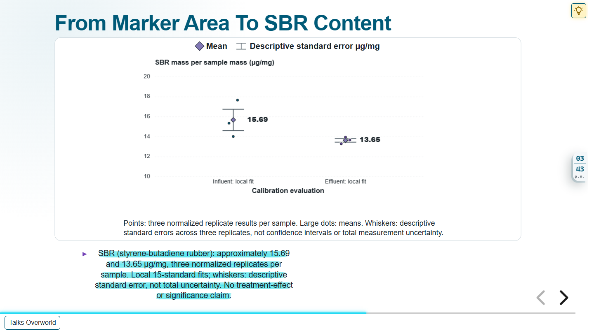

Narrative intention: Local calibration and normalization explain the displayed SBR results without a treatment claim.

Time budget: 80 seconds, including 5 planned seconds for pauses, pointing and transition. Supplied word count: 138; whitespace-token count: 138.

Visual composition: Return to the exact local-only two-group SBR result chart. No neighboring-window series.

Path step: `ex:eh26-step-08`. Scene: `ex:eh26-scene-08`. Heading: `ex:eh26-heading-08`. Visual: `ex:ted-sample-comparison-chart`. Takeaway: `ex:eh26-statement-08`. Items: `ex:eh26-item-08-1`, `-2`, `-3`.

Actual authored source files (selected visual and outgoing semantic dependencies):

- `ontology/dataset/talks-ted-calibration.trig`
- `ontology/dataset/talks-ted-sample-comparison.trig`

Reveal cues, keyed to the exact V1 paragraph starts below:

- P1, "Let us return to the samples.": Entry: both existing local-fit groups visible.
- P2, "We use a local linear calibration fitted to fifteen standards to convert each replicate's marker area into an estimated SBR mass.": Hold for inverse prediction using 15 standards.
- P3, "We then normalize by the amount of sample analyzed.": Point to normalization.
- P4, "For the example shown, the influent has a mean of approximately fifteen point seven micrograms of SBR per milligram of sample.": Point to influent mean; paragraph 5 points to effluent.
- P6, "Each mean is based on three normalized replicate results.": Point to replicate dots, then paragraph 7 to descriptive whiskers.
- P8, "These two numbers should not be interpreted as proof of a treatment effect.": Hold through the treatment-effect limitation and final provenance paragraphs.

Voice-over V1:

P1. Let us return to the samples.

P2. We use a local linear calibration fitted to fifteen standards to convert each replicate's marker area into an estimated SBR mass.

P3. We then normalize by the amount of sample analyzed.

P4. For the example shown, the influent has a mean of approximately fifteen point seven micrograms of SBR per milligram of sample.

P5. The effluent has approximately thirteen point six.

P6. Each mean is based on three normalized replicate results.

P7. The error bars represent descriptive standard errors, not a complete uncertainty assessment.

P8. These two numbers should not be interpreted as proof of a treatment effect.

P9. My main point is different: the reported result depends on the exact marker area, local calibration model, normalization and processing choices.

P10. All of them must remain traceable.

P11. The sample and calibration identifiers must therefore remain linked to the reported results.

## 09. Making the Entire Pipeline FAIR

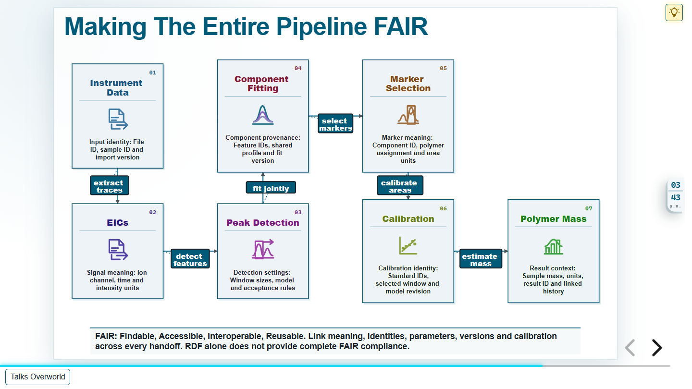

Narrative intention: Carry meaning and provenance through the same scientific chain, not a separate FAIR grid.

Time budget: 100 seconds, including 5 planned seconds for pauses, pointing and transition. Supplied word count: 167; whitespace-token count: 167.

Visual composition: Second seven-node flow with exactly matching scientific labels and edges; semantic node descriptions expose the provenance on those steps.

Path step: `ex:eh26-step-09`. Scene: `ex:eh26-scene-09`. Heading: `ex:eh26-heading-09`. Visual: `ex:eh26-semantic-processing-flow`. Takeaway: `ex:eh26-statement-09`. Items: `ex:eh26-item-09-1`, `-2`, `-3`.

Actual authored source files (selected visual and outgoing semantic dependencies):

- `ontology/dataset/talks-environmental-health-2026.trig`
- `ontology/dataset/talks-ted-calibration.trig`
- `ontology/dataset/talks-ted-fair.trig`
- `ontology/dataset/talks-ted-knowledge.trig`
- `ontology/dataset/talks-ted-processing.trig`
- `ontology/dataset/talks-ted-revisions.trig`
- `ontology/dataset/talks-ted-sample-comparison.trig`

Reveal cues, keyed to the exact V1 paragraph starts below:

- P1, "This brings us to FAIR: Findable, Accessible, Interoperable, and Reusable.": Entry semantic state 1: same Instrument Data and EIC labels, now with identity and signal-meaning parts.
- P2, "FAIR is often discussed as a property of a final dataset. In analytical chemistry, we need to think about the entire processing history.": Hold for whole-history framing.
- P3, "A result should point to its input file, the selected ion traces, extracted features, chosen polymer marker, calibration data, processing parameters, and software version.": Next state 2 for detection settings, next state 3 for feature/component links, next state 4 for marker identity, next state 5 for calibration and result context.
- P4, "Describing these relations in a shared, machine-readable vocabulary gives each step an explicit meaning.": Hold the complete linked chain through paragraphs 4 to 6.
- P7, "But a structured file alone is not enough to make data FAIR.": Hold for the distinction between structured data and complete FAIR compliance.
- P8, "Persistent identifiers, discovery, appropriate access, provenance, licenses, and community standards also matter.": Keep the statement visible for identifiers, access, licensing and standards; hold through paragraph 11.

Voice-over V1:

P1. This brings us to FAIR: Findable, Accessible, Interoperable, and Reusable.

P2. FAIR is often discussed as a property of a final dataset. In analytical chemistry, we need to think about the entire processing history.

P3. A result should point to its input file, the selected ion traces, extracted features, chosen polymer marker, calibration data, processing parameters, and software version.

P4. Describing these relations in a shared, machine-readable vocabulary gives each step an explicit meaning.

P5. Another tool can distinguish a marker area from a polymer mass, or a parameter from a measured value.

P6. This supports interoperability and reuse.

P7. But a structured file alone is not enough to make data FAIR.

P8. Persistent identifiers, discovery, appropriate access, provenance, licenses, and community standards also matter.

P9. FAIR does not necessarily mean that every file is openly accessible.

P10. The practical goal is simple: preserve the context needed to understand and reuse the result without relying on the original analyst's memory.

P11. RDF-based descriptions can link scientific objects across software boundaries, alongside the numerical results and their provenance.

## 10. Can We Validate the Pipeline?

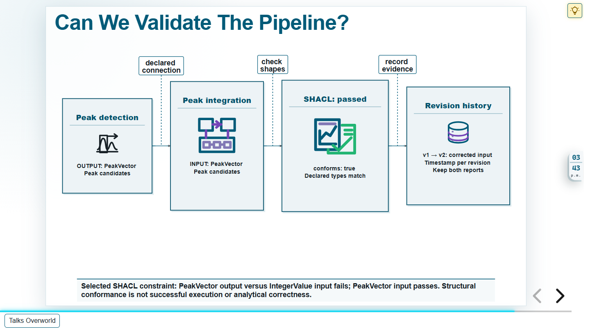

Narrative intention: An explicit structural constraint can detect a declared incompatibility.

Time budget: 90 seconds, including 5 planned seconds for pauses, pointing and transition. Supplied word count: 150; whitespace-token count: 150.

Visual composition: Existing before/after validation diagram and visible check limitation, without requiring any dialog.

Path step: `ex:eh26-step-10`. Scene: `ex:eh26-scene-10`. Heading: `ex:eh26-heading-10`. Visual: `ex:ted-validation-flow`. Takeaway: `ex:eh26-statement-10`. Items: `ex:eh26-item-10-1`, `-2`, `-3`.

Actual authored source files (selected visual and outgoing semantic dependencies):

- `ontology/dataset/talks-ted-revisions.trig`
- `ontology/dataset/talks-ted-validation.trig`

Reveal cues, keyed to the exact V1 paragraph starts below:

- P1, "A machine-readable pipeline offers another advantage: we can check whether its steps are structurally compatible.": Entry: existing bad state is non-empty.
- P2, "Consider a simple example.": Hold through the simple-example framing.
- P3, "One processing step produces a vector of detected peaks. The following step is initially declared to accept a single integer.": Point to PeakVector and IntegerValue.
- P4, "The connection looks plausible in a diagram, but the declared interfaces do not match.": Point to the declared incompatible connection.
- P5, "Using SHACL, a language for validating RDF descriptions against explicit constraints, we can detect that mismatch and obtain a validation report.": Point to failed SHACL report.
- P6, "After correcting the expected input to a peak vector, the same selected check passes.": Next: existing corrected-input state and passed report.
- P7, "We also record the revision and its validation evidence.": Point to revision history, then hold through the structural/scientific limitation and final contract requirements.

Voice-over V1:

P1. A machine-readable pipeline offers another advantage: we can check whether its steps are structurally compatible.

P2. Consider a simple example.

P3. One processing step produces a vector of detected peaks. The following step is initially declared to accept a single integer.

P4. The connection looks plausible in a diagram, but the declared interfaces do not match.

P5. Using SHACL, a language for validating RDF descriptions against explicit constraints, we can detect that mismatch and obtain a validation report.

P6. After correcting the expected input to a peak vector, the same selected check passes.

P7. We also record the revision and its validation evidence.

P8. This tested teaching example demonstrates an interface check, not proof that the algorithm is scientifically correct or will execute successfully.

P9. Nevertheless, it allows us to identify certain workflow errors before running the full analysis.

P10. That is a concrete benefit of transparent semantics.

P11. Real interface contracts also need units, data structures, and required parameters.

## 11. Towards Controlled Automation

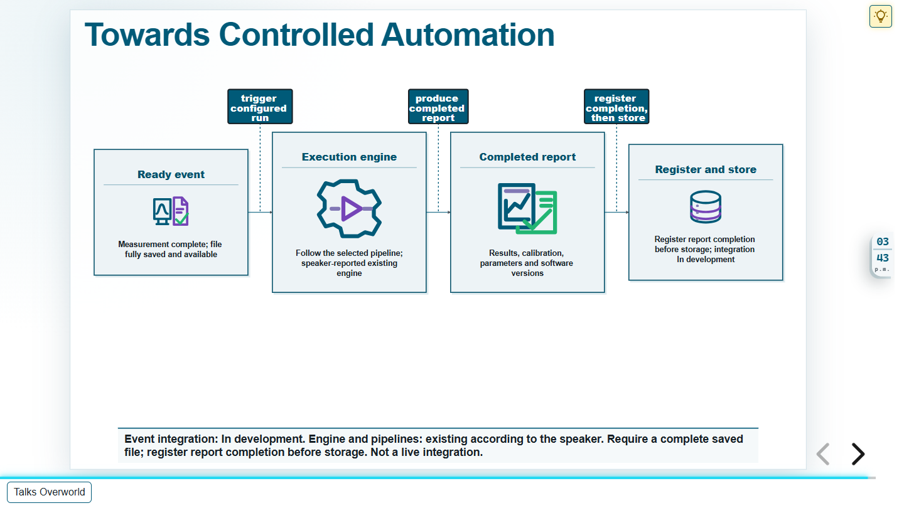

Narrative intention: Readiness, controlled execution and completed-report handling are separate responsibilities.

Time budget: 70 seconds, including 5 planned seconds for pauses, pointing and transition. Supplied word count: 119; whitespace-token count: 119.

Visual composition: New event, engine, completed-report and register/store flow. Development status remains visible in the statement.

Path step: `ex:eh26-step-11`. Scene: `ex:eh26-scene-11`. Heading: `ex:eh26-heading-11`. Visual: `ex:eh26-controlled-automation-flow`. Takeaway: `ex:eh26-statement-11`. Items: `ex:eh26-item-11-1`, `-2`, `-3`.

Actual authored source files (selected visual and outgoing semantic dependencies):

- `ontology/dataset/talks-environmental-health-2026.trig`
- `ontology/dataset/talks-ted-ai.trig`
- `ontology/dataset/talks-ted-development-status.trig`
- `ontology/dataset/talks-ted-semantic-execution.trig`

Reveal cues, keyed to the exact V1 paragraph starts below:

- P1, "Finally, the same explicit descriptions can support controlled automation.": Entry state 1: ready-event node already visible.
- P2, "Imagine that a TED-GC-MS measurement has finished and its data file is complete.": Point to measurement completion and fully saved, available file.
- P3, "A readiness event can trigger an execution engine.": Next state 2: trigger the speaker-reported engine.
- P4, "The engine follows the defined pipeline, runs the appropriate processing steps, and produces a report linked to its inputs, parameters, calibration and software versions.": Next state 3: completed report and register/store sequence.
- P5, "The report can then be registered and stored.": Hold for registration before storage.
- P6, "Our processing engine and semantically described pipelines already exist, while the fully integrated event-driven system is still under development.": Point to visible In development status; hold through paragraphs 7 and 8.

Voice-over V1:

P1. Finally, the same explicit descriptions can support controlled automation.

P2. Imagine that a TED-GC-MS measurement has finished and its data file is complete.

P3. A readiness event can trigger an execution engine.

P4. The engine follows the defined pipeline, runs the appropriate processing steps, and produces a report linked to its inputs, parameters, calibration and software versions.

P5. The report can then be registered and stored.

P6. Our processing engine and semantically described pipelines already exist, while the fully integrated event-driven system is still under development.

P7. So this diagram is an architecture and development direction, not a claim of a fully deployed autonomous laboratory.

P8. The important distinction is between automating a sequence of computations and automating a process whose decisions can still be inspected.

## 12. Conclusions

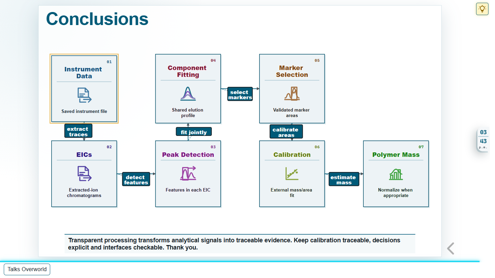

Narrative intention: Transparent processing turns signals into traceable evidence without a black box.

Time budget: 35 seconds, including 5 planned seconds for pauses, pointing and transition. Supplied word count: 60; whitespace-token count: 60.

Visual composition: Explicit reprise of the actual core processing flow selected on slide 05, with a concise final scientific statement.

Path step: `ex:eh26-step-12`. Scene: `ex:eh26-scene-12`. Heading: `ex:eh26-heading-12`. Visual: `ex:eh26-processing-flow`. Takeaway: `ex:eh26-statement-12`. Items: `ex:eh26-item-12-1`, `-2`, `-3`.

Actual authored source files (selected visual and outgoing semantic dependencies):

- `ontology/dataset/talks-environmental-health-2026.trig`
- `ontology/dataset/talks-ted-calibration.trig`
- `ontology/dataset/talks-ted-knowledge.trig`
- `ontology/dataset/talks-ted-processing.trig`
- `ontology/dataset/talks-ted-revisions.trig`
- `ontology/dataset/talks-ted-sample-comparison.trig`

Reveal cues, keyed to the exact V1 paragraph starts below:

- P1, "To conclude, TED-GC-MS provides valuable chemical information for mass-based microplastics analysis.": Entry core state 1: same Instrument Data and EICs as slide 05.
- P2, "Automated processing helps us turn signals into results, but speed alone is not enough.": Next core state 2: Peak Detection.
- P3, "We also need traceable calibration, explicit processing steps, and checkable interfaces.": Next core state 3: Component Fitting; next core state 4: Marker Selection.
- P4, "The goal is not to hide analytical decisions inside software.": Next core state 5: Calibration and Polymer Mass.
- P5, "It is to make them visible, checkable, and reusable.": Hold full chain for visible, checkable and reusable decisions.
- P6, "Thank you for your attention.": Hold final message and thank the audience. Total slide budget remains 35 seconds.

Voice-over V1:

P1. To conclude, TED-GC-MS provides valuable chemical information for mass-based microplastics analysis.

P2. Automated processing helps us turn signals into results, but speed alone is not enough.

P3. We also need traceable calibration, explicit processing steps, and checkable interfaces.

P4. The goal is not to hide analytical decisions inside software.

P5. It is to make them visible, checkable, and reusable.

P6. Thank you for your attention.
